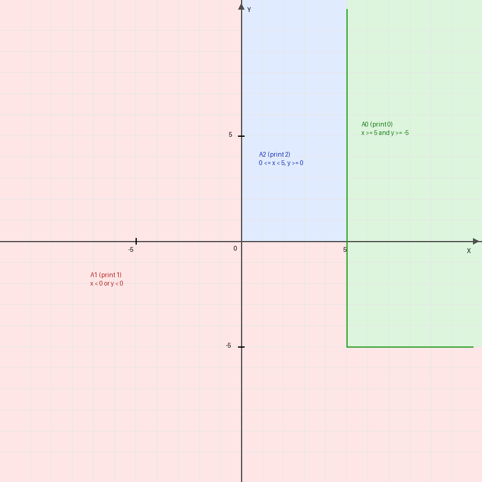

# Языки программирования
## Лабораторная работа 8

### Задание 1 **(2)**
*Рассмотрим программу на языке* **Python**.
```python
x = [int(t) for t in input().split()]
for i in range(len(x)):
   if x[i] < i or x[i] > 2*i:
      break
print(i)
```
*Перепишите эту программу так, чтобы в ней использовался цикл* **while**, *в ней не использовалась
инструкция* **break**, *а используемый алгоритм не изменился. Полученная программа должна иметь следующий 
вид.*
```python
x = [int(t) for t in input().split()]
i = 0
while ...:
   i += 1
print(i)
```
*Допишите правильное логическое выражение вместо многоточия. Выражение не должно содержать оператор* **not**.

**Решение.**
Текст программы сохранён в папке `1/task1.py`.

```python
x = [int(t) for t in input().split()]
i = 0
while i < len(x) - 1 and i <= x[i] <= 2 * i:
    i += 1
print(i)
```

**Объяснение:**
По правилам структурного программирования условие продолжения цикла — это отрицание условия выхода. В исходной программе выход по break происходил, когда `x[i] < i or x[i] > 2*i`.
По закону де Моргана отрицанием условия «меньше i или больше 2*i» является условие «не меньше i и не больше 2*i», то есть $x[i] \ge i$ и $x[i] \le 2i$. В Python это записывается как `i <= x[i] <= 2*i` (или `x[i] >= i and x[i] <= 2*i`).
Также добавлено условие `i < len(x) - 1`, чтобы индекс не вышел за пределы списка и программа не завершилась с ошибкой IndexError. Если break в исходной программе ни разу не сработал, то значение i после цикла останется равным последнему индексу списка (`len(x) - 1`).

---

### Задание 2 **(2)**
*Рассмотрим программу на языке* **Python**.
```python
x = [int(t) for t in input().split()]
for i in range(len(x)):
   if i <= x[i] < 2*i or 3*i <= x[i] < 4*i:
      break
print(i)
```
*Перепишите эту программу так, чтобы в ней использовался цикл* **while**, *в ней не использовалась
инструкция* **break**, *а используемый алгоритм не изменился. Полученная программа должна иметь следующий 
вид.*
```python
x = [int(t) for t in input().split()]
i = 0
while ...:
   i += 1
print(i)
```
*Допишите правильное логическое выражение вместо многоточия. Выражение не должно содержать оператор* **not**.

**Решение.**
Текст программы сохранён в папке `2/task2.py`.

```python
x = [int(t) for t in input().split()]
i = 0
while i < len(x) - 1 and (x[i] < i or 2 * i <= x[i] < 3 * i or x[i] >= 4 * i):
    i += 1
print(i)
```

**Объяснение:**
В исходной программе break срабатывает, если значение $x[i]$ попадает в один из двух диапазонов: $[i, 2i)$ или $[3i, 4i)$.
Чтобы цикл продолжался, значение $x[i]$ должно находиться вне этих двух диапазонов. На числовой прямой остаются три разрешённые области:
1. $x[i] < i$
2. $2i \le x[i] < 3i$
3. $x[i] \ge 4i$
Объединяем их через `or` и добавляем ограничение на границу списка `i < len(x) - 1`.

---

### Задание 3 **(2)**
*Напишите пример программы на* **Java** *с двумя вложенными циклами и инструкцией* **break** *для выхода
из двух вложенных циклов. В качестве такой программы можно взять поиск первого нуля в двумерном массиве.*

**Решение.**
Текст программы сохранён в папке `3/Main.java`.

```java
public class Main {
    public static void main(String[] args) {
        int[][] a = {
            {1, 2, 3},
            {4, 0, 5},
            {6, 7, 8}
        };
        int row = -1;
        int col = -1;
        search:
        for (int i = 0; i < a.length; i++) {
            for (int j = 0; j < a[i].length; j++) {
                if (a[i][j] == 0) {
                    row = i;
                    col = j;
                    break search;
                }
            }
        }
        System.out.println(row + " " + col);
    }
}
```

**Объяснение:**
В Java перед внешним циклом ставится метка (в примере `search:`). Инструкция `break search;` сразу прерывает выполнение обоих вложенных циклов и передаёт управление за пределы внешнего цикла. Для матрицы из примера программа находит первый ноль на позиции строка 1, столбец 1 и выводит `1 1`.

---

### Задание 4 **(2)**
*Рассмотрим программу на языке* **Python**.
```python
a = list(range(10))
b = [a.pop() - x for x in a]
print(*b)
```
*Объясните, почему список* **b** *получился именно таким.*

**Решение.**
При запуске программа выводит:
`9 7 5 3 1`

**Объяснение:**
Здесь происходит изменение (мутация) списка `a` прямо во время итерации по нему:
1. Цикл `for x in a` идёт по индексам списка слева направо (0, 1, 2, ...).
2. Метод `a.pop()` на каждом шаге удаляет последний элемент списка и уменьшает его длину на 1.
3. Пошаговое выполнение:
   - Шаг 1: индекс 0, берётся `x = 0`. Вызывается `a.pop()`, который удаляет и возвращает `9`. В список `b` идёт `9 - 0 = 9`. В списке `a` осталось 9 элементов (индексы 0..8).
   - Шаг 2: индекс 1, берётся `x = 1`. `a.pop()` возвращает `8`. В `b` идёт `8 - 1 = 7`. В `a` осталось 8 элементов.
   - Шаг 3: индекс 2, берётся `x = 2`. `a.pop()` возвращает `7`. В `b` идёт `7 - 2 = 5`. В `a` осталось 7 элементов.
   - Шаг 4: индекс 3, берётся `x = 3`. `a.pop()` возвращает `6`. В `b` идёт `6 - 3 = 3`. В `a` осталось 6 элементов.
   - Шаг 5: индекс 4, берётся `x = 4`. `a.pop()` возвращает `5`. В `b` идёт `5 - 4 = 1`. В `a` осталось 5 элементов: `[0, 1, 2, 3, 4]`.
   - Шаг 6: итератор пытается перейти к индексу 5, но текущая длина списка `a` теперь равна 5 (допустимые индексы только 0..4). Цикл завершается.
В результате в списке `b` оказывается ровно 5 элементов: `[9, 7, 5, 3, 1]`.

---

### Задание 5 **(2)**
*Напишите программу на С++, которая прочитает натуральное число* **n**, *создаст вектор
из* **n** *элементов, прочитает значения элементов, добавит последний элемент вектора к каждому элементу 
(в том числе и к последнему), найдет и выведет количество положительных и отрицательных элементов вектора
после изменения. Из циклов в программе можно использовать только циклы по коллекции.*

**Решение.**
Текст программы сохранён в папке `5/main.cpp`.

```cpp
#include <iostream>
#include <vector>

using namespace std;

int main() {
    int n;
    cin >> n;
    vector<int> v(n);
    for (int &x : v) {
        cin >> x;
    }
    int last = v.back();
    for (int &x : v) {
        x += last;
    }
    int pos = 0;
    int neg = 0;
    for (int x : v) {
        if (x > 0) {
            pos++;
        }
        if (x < 0) {
            neg++;
        }
    }
    cout << pos << " " << neg << endl;
    return 0;
}
```

**Объяснение:**
В программе использованы только циклы по коллекции (`range-based for`):
1. Первый цикл читает элементы по ссылке `int &x`.
2. Значение последнего элемента сохраняется в переменную `last = v.back()`, чтобы при его изменении в цикле прибавлялось исходное значение.
3. Второй цикл прибавляет `last` к каждому элементу по ссылке.
4. Третий цикл подсчитывает количество положительных и отрицательных чисел.
Программа протестирована с помощью g++, при вводе `5` и чисел `-5 0 2 -1 3` выводит `4 1`.

---

### Задание 6 **(3)**
*Представим, что в некотором будущем стандарте* **С++** *появится конструкция*
```cpp
forc(i, from, to)
```
*которая будет раскрываться в следующий код.*
```cpp
{
   int __i = from, __n=to;
   for(const int &i= __i; i < __n; __i++) {
      ...
   }
}
```
*Чем эта конструкция отличается от стандартного цикла* **for**? *Укажите два основных различия.
Напишите программы для демонстрации этих различий.*

**Решение.**
Программы сохранены в папке `6/prog1.cpp` и `6/prog2.cpp`.

**Два основных различия:**
1. **Переменная цикла i константная (`const int &i`).**
   В обычном цикле `for (int i = 0; i < n; i++)` переменную `i` можно случайно изменить внутри тела цикла (например, `i++` или `i = 10`), что нарушает логику цикла со счётчиком. В конструкции `forc` переменная `i` объявлена как константная ссылка. При попытке изменить её внутри тела компилятор выдаст ошибку `assignment of read-only reference 'i'`.
2. **Верхняя граница to вычисляется один раз перед входом в цикл.**
   В обычном цикле выражение `i < to` пересчитывается заново на каждой итерации. Если `to` — это вызов функции, она будет вызываться каждый раз. В `forc` значение сохраняется в `__n = to` ровно один раз перед стартом цикла.

**Программа 1 (демонстрация неизменяемости счетчика):**
```cpp
#include <iostream>

using namespace std;

#define forc(i, from, to) \
    int __i = from, __n = to; \
    for (const int &i = __i; i < __n; __i++)

int main() {
    forc(i, 0, 5) {
        cout << i << " ";
        // i++; // Ошибка компиляции: increment of read-only reference 'i'
    }
    cout << endl;
    return 0;
}
```

**Программа 2 (демонстрация однократного вычисления границы):**
```cpp
#include <iostream>

using namespace std;

#define forc(i, from, to) \
    int __i = from, __n = to; \
    for (const int &i = __i; i < __n; __i++)

int count_calls = 0;

int get_to() {
    count_calls++;
    return 3;
}

int main() {
    count_calls = 0;
    forc(i, 0, get_to()) {
    }
    cout << count_calls << endl;

    count_calls = 0;
    for (int i = 0; i < get_to(); i++) {
    }
    cout << count_calls << endl;

    return 0;
}
```
Вывод программы 2:
```
1
4
```
В `forc` функция `get_to()` вызвалась 1 раз, а в обычном `for` — 4 раза.

---

### Задание 7 **(2)**
*Напишите программу на языке Python для проверки того, что все числа во введенной 
последовательности неотрицательные. Если в цикле будет найдено отрицательное число, цикл должен
прерваться и вывести найденное число. Если отрицательных чисел нет, то вывести некоторое сообщение об этом.*

*Программа должна использовать конструкцию* **for break else**.

*Запишите аналогичную программу на С++. Какие изменения в алгоритме решения в ней появились?. Почему?*

**Решение.**
Программы сохранены в папке `7/task7.py` и `7/task7.cpp`.

**Программа на Python:**
```python
a = [int(t) for t in input().split()]
for x in a:
    if x < 0:
        print(x)
        break
else:
    print("all non-negative")
```

**Программа на C++:**
```cpp
#include <iostream>
#include <vector>

using namespace std;

int main() {
    int n;
    if (!(cin >> n)) {
        return 0;
    }
    vector<int> a(n);
    for (int &x : a) {
        cin >> x;
    }
    bool found = false;
    for (int x : a) {
        if (x < 0) {
            cout << x << endl;
            found = true;
            break;
        }
    }
    if (!found) {
        cout << "all non-negative" << endl;
    }
    return 0;
}
```

**Ответ на вопрос:**
В C++ у циклов отсутствует конструкция `else`. Поэтому для отслеживания того, был ли выход из цикла досрочным (по `break`) или естественным (цикл дошёл до конца), приходится вручную добавлять логическую переменную-флаг `bool found = false;`. Перед вызовом `break` флаг выставляется в `true`, а после завершения цикла проверяется условием `if (!found)`.

---

### Задание 8 **(2)**
*Рассмотрим следующую программу.* 
```python
if x>=5 and y>=-5:
   print(0)
elif x<0 or y<0:
   print(1)
else:
   print(2)
```
*Нарисуйте на координатной плоскости множества значений при которых программа выводит 0, 1 и 2.*
*Фотографию рисунка вставьте в отчет*
*Опишите эти множества значений, используя язык теории множеств.*

**Решение.**
Изображение сохранено в файле `task8_plot.png`.



**Описание множеств на языке теории множеств:**
1. **Множество $A_0$ (вывод 0):**
   Срабатывает первое условие ветвления:
   $$A_0 = \{ (x, y) \mid x \ge 5 \land y \ge -5 \} = [5, +\infty) \times [-5, +\infty)$$
   Геометрически это угол в правой части плоскости с вершиной в точке $(5, -5)$, включая границы.

2. **Множество $A_1$ (вывод 1):**
   Срабатывает ветка `elif x < 0 or y < 0` при условии, что точка не попала в $A_0$:
   $$A_1 = \{ (x, y) \mid x < 0 \} \cup \{ (x, y) \mid y < -5 \} \cup \{ (x, y) \mid 0 \le x < 5 \land -5 \le y < 0 \}$$
   Точки с $x \ge 5$ и $-5 \le y < 0$ сюда не попадают, так как они обрабатываются первой веткой и дают 0.

3. **Множество $A_2$ (вывод 2):**
   Срабатывает ветка `else` (когда ни одно из предыдущих условий не выполнено):
   $$A_2 = \{ (x, y) \mid 0 \le x < 5 \land y \ge 0 \} = [0, 5) \times [0, +\infty)$$
   Геометрически это полубесконечная вертикальная полоса в первом квадранте шириной от $x = 0$ до $x = 5$ (не включая 5), при $y \ge 0$.

---

### Задание 9 **(3)**
*Напишите программу на языке Python для решения следующей задачи.*

*Задана пронумерованная последовательность логических значений* **t(0), t(1), ..., t(n)**, **t(i) ∈ {False, True}**
*Последовательность обладает следующим свойством: существует некоторое число k такое, что 
все значения* **t(0), t(1), ..., t(k-1)** *равны* **False**, *а все значения* **t(k), ..., t(n)** *равны* **True**,
*то есть слева от* **k** *находятся значения* **False**, *а справа* - **True**.*

*Алгоритм должен быть записан через цикл* **while** *и реализовывать инвариант цикла*
$t(\text{left}) = \text{False} \land t(\text{right}) = \text{True}$.

**Решение.**
Текст программы сохранён в папке `9/task9.py`.

```python
def t(i):
    return i >= 1000

left = -1
right = 10**18
while right - left > 1:
    mid = (left + right) // 2
    if t(mid):
        right = mid
    else:
        left = mid
print(right)
```

**Объяснение:**
Инвариант цикла: $t(\text{left}) = \text{False} \land t(\text{right}) = \text{True}$.
- Изначально `left = -1` (считаем, что до нулевого элемента значение False) и `right = 10**18` (значение True). Инвариант истинен при входе в цикл.
- На каждом шаге вычисляется середина `mid`. Если `t(mid)` истинно, сдвигаем правую границу `right = mid`. Если ложно — сдвигаем левую `left = mid`. В обоих случаях инвариант сохраняется.
- Цикл продолжается, пока `right - left > 1`. При выходе из цикла `right - left == 1`, то есть `left` — это последний индекс со значением False, а `right` — первый индекс со значением True (число $k$). Поэтому `right` является искомым ответом.

---

## Дополнительные задания

### Задание 1 **(5)**
*Напишите программу на языке С++, которая будет находить сумму элементов в матрице и использовать для суммирования только один цикл* **for**. *(То есть вложенные циклы использовать нельзя).*

**Решение.**
Текст программы сохранён в папке `dop1/main.cpp`.

```cpp
#include <iostream>
#include <vector>

using namespace std;

int main() {
    int n, m;
    if (!(cin >> n >> m)) {
        return 0;
    }
    vector<vector<int>> a(n, vector<int>(m));
    for (int i = 0; i < n * m; i++) {
        cin >> a[i / m][i % m];
    }
    long long sum = 0;
    for (int i = 0; i < n * m; i++) {
        sum += a[i / m][i % m];
    }
    cout << sum << endl;
    return 0;
}
```

**Объяснение:**
Матрица размера $N \times M$ содержит $N \cdot M$ элементов. Вместо двух вложенных циклов используется один цикл со счётчиком `i` от 0 до $N \cdot M - 1$. Номер строки вычисляется как целочисленное деление `i / m`, а номер столбца — как остаток от деления `i % m`. Это позволяет обойти и просуммировать всю матрицу строго за один цикл `for`.
