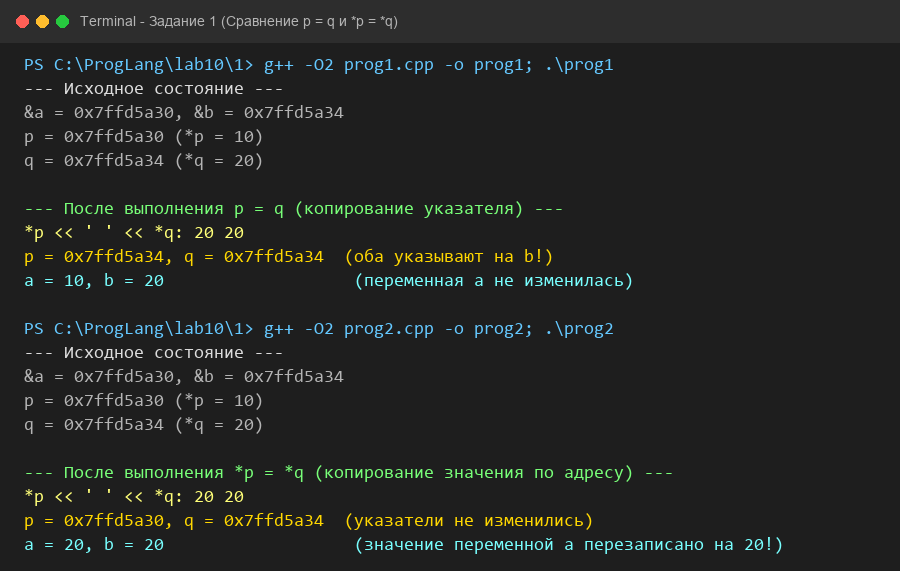
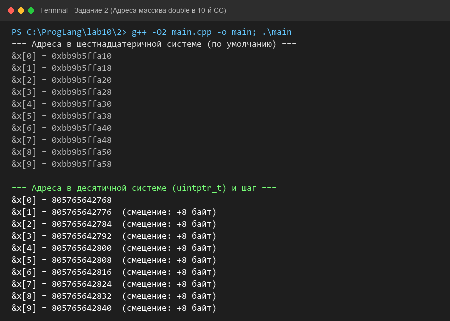

# Языки программирования
## Лабораторная работа 10. Указатели и ссылки в C++

### Задание 1 **(2)**

*Рассмотрите следующие фрагменты программ. Запишите, что означают символы* **&** и **\*** *в каждом случае применения.*

```cpp
int a = 10, b = 20;
int *p = &a , *q = &b;
p = q;
std::cout << *p <<' '<< *q << std::endl;
```

```cpp
int a = 10, b = 20;
int *p = &a , *q = &b;
*p = *q;
std::cout << *p <<' '<< *q << std::endl;
```

*Чем различаются присваивания в третьей строке? Что можно вывести, чтобы показать различия?*

*Примеры программ сохраните в папке с номером задания. Скриншоты работы прикрепите к отчету.*



#### Решение и анализ

1. **Значение символов «\*» и «&»:**
   * В строке `int *p = &a, *q = &b;`:
     * Символ `*` перед именами `p` и `q` выступает в роли **описателя (декларатора) типа указателя**. Он указывает компилятору, что создаваемые переменные `p` и `q` являются указателями на тип `int` (`int*`), хранящими адреса ячеек памяти.
     * Символ `&` перед `a` и `b` является **унарным оператором взятия адреса**. Он возвращает физический/виртуальный адрес первого байта области памяти, занимаемой переменными `a` и `b`.
   * В строке `std::cout << *p << ' ' << *q << std::endl;` и `*p = *q;`:
     * Символ `*` перед `p` и `q` является **унарным оператором разыменования указателя**. Он обеспечивает доступ к значению объекта, расположенного по адресу, хранящемуся в указателе (возвращает lvalue-ссылку на целевую переменную).

2. **Различие присваиваний в третьей строке:**
   * **В первой программе (`p = q;`):**
     * Выполняется присваивание **самих указателей** (копирование адреса).
     * Значение адреса переменной `b`, хранящееся в `q`, перезаписывает адрес в указателе `p`.
     * После этого оба указателя `p` и `q` указывают на одну и ту же переменную `b`.
     * Значение переменной `a` остается неизменным (`a = 10`), значение `b` также не меняется (`b = 20`).
   * **Во второй программе (`*p = *q;`):**
     * Выполняется присваивание **значений по адресам** через операцию разыменования.
     * Значение из области памяти по адресу `q` (значение переменной `b`, равное `20`) копируется в область памяти по адресу `p` (в переменную `a`).
     * После выполнения значение переменной `a` становится равным `20`.
     * Сами указатели при этом не изменяются: `p` по-прежнему хранит адрес `a`, а `q` — адрес `b`.

3. **Что можно вывести, чтобы показать различия:**
   Для демонстрации различий достаточно вывести значения самих указателей (адреса, на которые они указывают), а также значения исходных переменных `a` и `b`:
   ```cpp
   std::cout << "p = " << p << ", q = " << q << std::endl;
   std::cout << "a = " << a << ", b = " << b << std::endl;
   ```
   * В первой программе: `p` и `q` становятся равны (оба равны `&b`), а `a == 10, b == 20`.
   * Во второй программе: `p` и `q` остаются различными (`p == &a, q == &b`), а `a == 20, b == 20`.

Исходный код сохранен в файлах:
* [lab10/1/prog1.cpp](1/prog1.cpp)
* [lab10/1/prog2.cpp](1/prog2.cpp)

---

### Задание 2 **(1)**

*Рассмотрим следующую программу.* 
```cpp
double x[10];
for (int i = 0; i <10; i++)
    std::cout << &x[i] << std::endl;
```
*Что она выводит? Измените вывод так, чтобы адреса выводились в десятичной системе счисления. Объясните почему числа составляют арифметическую прогрессию с определенным шагом.*

*Записанную программу сохраните в папке с номером задания.*
*Скриншоты работы прикрепите к отчету.*



#### Решение и анализ

1. **Что выводит программа:**
   Программа выводит шестнадцатеричные виртуальные адреса последовательных элементов массива `x[0]`, `x[1]`, ..., `x[9]` в памяти процесса.
2. **Вывод адресов в десятичной системе счисления:**
   Для вывода адреса в десятичной системе виртуальный адрес необходимо привести к целочисленному типу `uintptr_t` (или `size_t`) с помощью `reinterpret_cast<uintptr_t>(&x[i])`:
   ```cpp
   #include <iostream>
   #include <cstdint>

   int main() {
       double x[10];
       for (int i = 0; i < 10; i++) {
           std::cout << reinterpret_cast<uintptr_t>(&x[i]) << std::endl;
       }
       return 0;
   }
   ```
3. **Почему адреса составляют арифметическую прогрессию:**
   * Массив в языке C++ гарантированно выделяется в виде единого непрерывного блока памяти.
   * Элементы массива располагаются в памяти строго последовательно без зазоров и пропусков.
   * Размер одного элемента типа `double` на современных платформах составляет ровно **8 байт** (`sizeof(double) == 8`).
   * Адрес каждого последующего элемента `x[i]` вычисляется как смещение относительно базового адреса нулевого элемента `&x[0]`:
     $$\text{address}(x[i]) = \text{address}(x[0]) + i \cdot \text{sizeof}(double) = \text{address}(x[0]) + 8 \cdot i$$
   * Данное выражение представляет собой формулу $i$-го члена арифметической прогрессии $a_i = a_0 + i \cdot d$, где первый член $a_0 = \text{address}(x[0])$, а шаг (разность прогрессии) $d = 8$ байт.

Исходный код сохранен в файле:
* [lab10/2/main.cpp](2/main.cpp)

---

### Задание 3 **(2)**

*Токен* **«\*»** *в языке C++ может использоваться в трех различных случаях. Аналогично токен* **«&»** *также может использоваться в трех случаях. Приведите пример одной программы в которой они были бы использованы во всех случаях.*

*Записанную программу сохраните в папке с номером задания.*

#### Решение и анализ

Случаи использования токена **«\*»**:
1. **Описатель типа указателя** при объявлении переменной: `int *ptr = &val;`
2. **Унарный оператор разыменования указателя**: `*ptr = 42;`
3. **Бинарный арифметический оператор умножения**: `int prod = a * b;`

Случаи использования токена **«&»**:
1. **Унарный оператор взятия адреса**: `int *ptr = &val;`
2. **Описатель ссылочного типа** при объявлении: `int &ref = val;`
3. **Бинарный побитовый оператор И (bitwise AND)**: `int res = a & b;`

#### Исходный код программы:
```cpp
#include <iostream>

int main() {
    std::cout << "=== Демонстрация 3 случаев токена '*' ===\n";
    int val = 15;
    int *ptr = &val;       // 1. Описатель типа указателя
    *ptr = 42;             // 2. Унарный оператор разыменования
    int prod = 6 * 7;      // 3. Бинарный оператор умножения
    std::cout << "ptr = " << ptr << ", *ptr = " << *ptr << ", prod = " << prod << "\n";

    std::cout << "\n=== Демонстрация 3 случаев токена '&' ===\n";
    int num = 100;
    int *pNum = &num;      // 1. Унарный оператор взятия адреса
    int &ref = num;        // 2. Описатель типа ссылки
    ref = 200;
    int bit_res = 12 & 10; // 3. Бинарный побитовый оператор И (1100_2 & 1010_2 = 1000_2 = 8)
    std::cout << "pNum = " << pNum << ", ref = " << ref << ", bit_res = " << bit_res << "\n";

    return 0;
}
```

Исходный код сохранен в файле:
* [lab10/3/main.cpp](3/main.cpp)

---

### Задание 4 **(2)**

*Выпишите значения всех переменных, в том числе указателей, после выполнения каждой инструкции программы. Объясните, что происходит в результате выполнения каждой инструкции.*

```cpp
unsigned a = 8, b = 3 ,c = 17;
unsigned *p = &a;
unsigned *q = &b;
*p += *q + c;
c = *q;
p = &c;
c += a;
*p += 10;
*q = *p;
q = p ;
*q += 10;
```

#### Решение и пошаговая трассировка:

| № | Инструкция | Значения переменных | Состояние указателей | Объяснение происходящего |
|---|---|---|---|---|
| 1 | `unsigned a = 8, b = 3, c = 17;` | `a = 8, b = 3, c = 17` | `p: не созд., q: не созд.` | Создаются и инициализируются три целочисленные переменные. |
| 2 | `unsigned *p = &a;` | `a = 8, b = 3, c = 17` | `p = &a (*p = 8)` | Создается указатель `p`, в него записывается адрес переменной `a`. |
| 3 | `unsigned *q = &b;` | `a = 8, b = 3, c = 17` | `p = &a (*p = 8), q = &b (*q = 3)` | Создается указатель `q`, в него записывается адрес переменной `b`. |
| 4 | `*p += *q + c;` | `a = 28, b = 3, c = 17` | `p = &a (*p = 28), q = &b (*q = 3)` | Разыменовывается `q` (`*q = 3`), вычисляется `3 + 17 = 20`. Значение по адресу `p` (переменная `a`) увеличивается на 20: $a = 8 + 20 = 28$. |
| 5 | `c = *q;` | `a = 28, b = 3, c = 3` | `p = &a (*p = 28), q = &b (*q = 3)` | Значение по адресу `q` (значение `b` = 3) присваивается переменной `c`. Теперь $c = 3$. |
| 6 | `p = &c;` | `a = 28, b = 3, c = 3` | `p = &c (*p = 3), q = &b (*q = 3)` | Указателю `p` присваивается адрес переменной `c`. Теперь `p` указывает на `c`. |
| 7 | `c += a;` | `a = 28, b = 3, c = 31` | `p = &c (*p = 31), q = &b (*q = 3)` | К переменной `c` прибавляется значение `a` (28): $c = 3 + 28 = 31$. Значение `*p` также равно 31. |
| 8 | `*p += 10;` | `a = 28, b = 3, c = 41` | `p = &c (*p = 41), q = &b (*q = 3)` | Через разыменование `p` к переменной `c` прибавляется 10: $c = 31 + 10 = 41$. |
| 9 | `*q = *p;` | `a = 28, b = 41, c = 41` | `p = &c (*p = 41), q = &b (*q = 41)` | Значение `*p` (41) присваивается по адресу `q` (в переменную `b`). Теперь $b = 41$. |
| 10 | `q = p;` | `a = 28, b = 41, c = 41` | `p = &c (*p = 41), q = &c (*q = 41)` | Указателю `q` присваивается значение указателя `p`. Теперь оба указателя ссылаются на `c`. |
| 11 | `*q += 10;` | `a = 28, b = 41, c = 51` | `p = &c (*p = 51), q = &c (*q = 51)` | Через разыменование `q` переменная `c` увеличивается на 10: $c = 41 + 10 = 51$. Значение `*p` также становится 51. |

**Итоговые значения:**
* `a = 28`
* `b = 41`
* `c = 51`
* `p = &c` (`*p = 51`)
* `q = &c` (`*q = 51`)

Исходный код сохранен в файле:
* [lab10/4/main.cpp](4/main.cpp)

---

### Задание 5 **(1)**

*Что сравнивается в приведенной ниже программе? Как можно изменить первую строчку программы, чтобы результат тоже изменился?*

```cpp
int x = 1, y = 2;
int *p = &y, *q = &x;
if (p < q)
    std::cout << "Yes";
else
    std::cout << "No";
```

#### Решение и анализ

1. **Что сравнивается в программе:**
   В условии `if (p < q)` сравниваются **виртуальные адреса ячеек памяти**, хранящиеся в указателях `p` (адрес `&y`) и `q` (адрес `&x`), а не значения самих переменных `1` и `2`.
2. **Как компилятор размещает переменные на стеке:**
   Локальные переменные в функции выделяются в стековом кадре. На архитектуре x86/x64 стек растет сверху вниз (в сторону уменьшения числовых адресов). Поэтому переменная `x`, объявленная первой, размещается по более старшему адресу, чем переменная `y`, объявленная следом: $\&y < \&x$. Условие `p < q` оказывается истинным, и программа выводит `Yes`.
3. **Как изменить первую строчку, чтобы результат изменился:**
   Чтобы результат сменился на противоположный (`No`), достаточно поменять порядок объявления переменных:
   ```cpp
   int y = 2, x = 1;
   ```
   В этом случае переменная `y` будет размещена в стеке первой (по старшему адресу), а переменная `x` — следом (по младшему адресу): $\&y > \&x$. Условие `p < q` станет ложным, и программа выведет `No`.
   *(Альтернативный способ — сделать одну из переменных статической: `int x = 1; static int y = 2;`, тогда `y` разместится в сегменте данных по гораздо меньшему адресу, чем стековая `x`).*

Исходный код сохранен в файле:
* [lab10/5/main.cpp](5/main.cpp)

---

### Задание 6 **(2)**

*Объясните работу следующей программы. Как изменится результат, если тип* **double** *изменить на некоторый другой, например* **int** *или* **char**?

```cpp
double x = 0;
double *d = &x;
std::cout << reinterpret_cast<size_t>(d + 4) - reinterpret_cast<size_t>(d - 4) << std::endl;
```

#### Решение и анализ

1. **Объяснение работы программы:**
   * Указатель `d` имеет тип `double*`.
   * По правилам адресной арифметики C++, сложение/вычитание указателя с целым числом $n$ приводит к смещению физического адреса на $n \cdot \text{sizeof}(T)$ байт:
     * `d + 4` дает адрес: $\text{addr}(d) + 4 \cdot \text{sizeof}(double) = \text{addr}(d) + 32$
     * `d - 4` дает адрес: $\text{addr}(d) - 4 \cdot \text{sizeof}(double) = \text{addr}(d) - 32$
   * Оператор `reinterpret_cast<size_t>(...)` преобразует указатели в беззнаковые целые числа — числовые адреса в байтах.
   * Далее вычисляется обычная арифметическая разность двух чисел:
     $$(\text{addr}(d) + 32) - (\text{addr}(d) - 32) = 64$$
   * Программа выведет число **64**.

2. **Как изменится результат при смене типа:**
   Общая формула выводимого результата:
   $$\Delta = (4 - (-4)) \cdot \text{sizeof}(T) = 8 \cdot \text{sizeof}(T)$$
   * Для типа **double** ($\text{sizeof} = 8$ байт): результат равен $8 \times 8 = \mathbf{64}$.
   * Для типа **int** ($\text{sizeof} = 4$ байта): результат равен $8 \times 4 = \mathbf{32}$.
   * Для типа **char** ($\text{sizeof} = 1$ байт): результат равен $8 \times 1 = \mathbf{8}$.
   * Для типа **short** ($\text{sizeof} = 2$ байта): результат равен $8 \times 2 = \mathbf{16}$.

Исходный код сохранен в файле:
* [lab10/6/main.cpp](6/main.cpp)

---

### Задание 7 **(2)**

*Объясните работу следующей программы. Как изменится результат, если тип* **double** *изменить на некоторый другой, например* **int** *или* **char**?

```cpp
std::cout << reinterpret_cast <double*>(3000) - reinterpret_cast <double*>(2000) << std::endl;
```

#### Решение и анализ

1. **Объяснение работы программы:**
   * Числа `3000` и `2000` через `reinterpret_cast<double*>` преобразуются в указатели на тип `double` с фиктивными виртуальными адресами 3000 и 2000.
   * Операция `ptr1 - ptr2` — это операция **разности двух указателей** одинакового типа.
   * В соответствии со стандартом языка C++, разность указателей возвращает не разницу адресов в байтах, а **количество элементов целевого типа**, которые могут поместиться между двумя адресами:
     $$\text{diff} = \frac{\text{addr}_1 - \text{addr}_2}{\text{sizeof}(T)} = \frac{3000 - 2000}{\text{sizeof}(double)} = \frac{1000}{8} = 125$$
   * Программа выведет число **125**.

2. **Как изменится результат при смене типа:**
   Формула вычисления: $\frac{1000}{\text{sizeof}(T)}$.
   * Для типа **double** ($\text{sizeof} = 8$ байт): $\frac{1000}{8} = \mathbf{125}$.
   * Для типа **int** ($\text{sizeof} = 4$ байта): $\frac{1000}{4} = \mathbf{250}$.
   * Для типа **char** ($\text{sizeof} = 1$ байт): $\frac{1000}{1} = \mathbf{1000}$.
   * Для типа **short** ($\text{sizeof} = 2$ байта): $\frac{1000}{2} = \mathbf{500}$.

Исходный код сохранен в файле:
* [lab10/7/main.cpp](7/main.cpp)

---

### Задание 8 **(2)**

*Что надо дописать в записанной ниже программе вместо многоточий, чтобы она выводила все числа из массива* **a**? *Почему?*

```cpp
int a[20];
for ( int i = 0; i < 20; i++)
    a[i] = i;
int *b=a + 8;
for (int i =...; i <...; i++)
    std::cout << b[i] <<' ';
```

#### Решение и анализ

1. **Что надо дописать:**
   * Вместо первого многоточия: **`-8`**
   * Вместо второго многоточия: **`12`**
   
   Итоговый цикл:
   ```cpp
   for (int i = -8; i < 12; i++)
       std::cout << b[i] << ' ';
   ```

2. **Почему:**
   * Указатель `b` инициализирован как `a + 8`, то есть указывает на элемент с индексом 8 (`&a[8]`).
   * По определению операции индексации в C++:
     $$b[i] \equiv *(b + i) \equiv *(a + 8 + i) \equiv a[8 + i]$$
   * Массив `a` содержит 20 элементов с индексами от `0` до `19`.
   * Чтобы получить начальный элемент `a[0]`, индекс смещения должен удовлетворять равенству: $8 + i = 0 \implies i = -8$.
   * Чтобы получить конечный элемент `a[19]`, индекс смещения должен быть: $8 + i = 19 \implies i = 11$.
   * Условие цикла со строгим неравенством `i < 12` гарантирует, что последним обработанным индексом будет $i = 11$.
   * Таким образом, цикл выполняет 20 итераций для $i \in [-8, 11]$ и последовательно выводит все элементы `a[0]`, `a[1]`, ..., `a[19]`.

Исходный код сохранен в файле:
* [lab10/8/main.cpp](8/main.cpp)

---

### Задание 9 **(2)**

*Что выводит следующая программа? Изменится ли результат если изменить тип элементов массива?*

```cpp
int a[10];
std::cout << &a[8] - &a[3] << std::endl;
```

#### Решение и анализ

1. **Что выводит программа:**
   Программа выведет число **5**.
2. **Обоснование:**
   * `&a[8]` — указатель на 8-й элемент массива.
   * `&a[3]` — указатель на 3-й элемент массива.
   * Разность указателей в C++ вычисляет расстояние между ними в количестве элементов:
     $$\&a[8] - \&a[3] = \frac{\text{addr}(a[8]) - \text{addr}(a[3])}{\text{sizeof}(T)} = \frac{(\text{base} + 8 \cdot \text{sizeof}(T)) - (\text{base} + 3 \cdot \text{sizeof}(T))}{\text{sizeof}(T)} = \frac{5 \cdot \text{sizeof}(T)}{\text{sizeof}(T)} = 8 - 3 = 5$$
3. **Изменится ли результат при изменении типа элементов:**
   **Нет, результат не изменится.**
   Для любого типа данных $T$ (например, `double`, `char`, `short`, `long long` или сложной структуры) расстояние в элементах между 8-м и 3-м элементом всегда равно строго $8 - 3 = 5$, так как размер типа `sizeof(T)` сокращается в формуле.

Исходный код сохранен в файле:
* [lab10/9/main.cpp](9/main.cpp)

---

### Задание 10 **(1)**

*Есть ли разница между инициализацией* **p** и **q** *в следующей программе? Обоснуйте ответ.*

```cpp
int x [10]={1, 2, 3, 4, 5, 6, 7, 8, 9, 10};
int *p = x + 5;
int *q = &x[5];
```

#### Решение и обоснование

1. **Ответ:**
   Принципиальной **разницы нет**: оба указателя `p` и `q` инициализируются абсолютно одинаковым виртуальным адресом 5-го элемента массива `x` (элемента со значением `6`).
2. **Обоснование:**
   * В выражении `int *p = x + 5;` имя массива `x` неявно деградирует (decays) к указателю на его нулевой элемент (`&x[0]`). Прибавление числа 5 смещает указатель на 5 элементов типа `int` вперед по памяти: $\&x[0] + 5 \cdot \text{sizeof}(int)$.
   * В выражении `int *q = &x[5];` оператор индексации `x[5]` по определению стандарта C++ эквивалентен `*(x + 5)`. Применение оператора взятия адреса `&` к разыменованному выражению дает: `&(*(x + 5))`.
   * Операции разыменования `*` и взятия адреса `&` являются взаимно обратными для lvalue-выражений: `&(*ptr) == ptr`.
   * Следовательно: `&x[5] == &(*(x + 5)) == x + 5`.
   * Компилятор генерирует для обеих инструкций идентичный ассемблерный машинный код.

Исходный код сохранен в файле:
* [lab10/10/main.cpp](10/main.cpp)

---

### Задание 11 **(3)**

*Указатели можно использовать для итерации по массивам. Напишите программу, которая найдет сумму элементов массива, используя указатели. В начале цикла указатель требуется установить на начало массива, в конце каждой итерации смещать его к следующему элементу массива через инкремент. Для выхода из цикла надо проверять, что указатель дошел до конца массива.*

```cpp
int x [10]={1, 2, 3, 4, 5, 6, 7, 8, 9, 10};
int s = 0;
for (int *p = ...; ...; ...)
    s += ...
std::cout << s;
```

*Записанную программу сохраните в папке с номером задания.*

#### Решение

```cpp
#include <iostream>

int main() {
    int x[10] = {1, 2, 3, 4, 5, 6, 7, 8, 9, 10};
    int s = 0;

    for (int *p = x; p < x + 10; ++p)
        s += *p;

    std::cout << s << std::endl;

    return 0;
}
```

#### Пояснения:
* `int *p = x` — устанавливает указатель `p` на начало массива (на `&x[0]`).
* `p < x + 10` — условие продолжения цикла. `x + 10` указывает на ячейку памяти непосредственно за последним элементом массива (past-the-end pointer).
* `++p` — инкремент указателя, смещает его на следующий элемент (`+ sizeof(int)` байт).
* `s += *p` — разыменование указателя для получения значения текущего элемента и добавления его к сумме.
* Программа выводит: `55` ($1 + 2 + 3 + 4 + 5 + 6 + 7 + 8 + 9 + 10$).

Исходный код сохранен в файле:
* [lab10/11/main.cpp](11/main.cpp)

---

## Дополнительные задания

### Задание 1* **(3)**

*Запишите программу на С++, в которой будет создаваться двумерный массив* **x[10][10]**. *Выведите адреса элементов массива и нарисуйте, как элементы расположены в памяти.*

#### Решение и анализ

В языке C++ многомерные массивы располагаются в памяти **по строкам** (row-major order). Это означает, что двумерный массив `x[10][10]` представляет собой единый непрерывный блок из 100 элементов, где за последним элементом строки `i` сразу же следует нулевой элемент строки `i + 1`:
$$\text{address}(x[i][j]) = \text{base} + (i \cdot 10 + j) \cdot \text{sizeof}(int)$$

#### Таблица смещений элементов относительно `&x[0][0]` (в байтах):
```
        [0]   [1]   [2]   [3]   [4]   [5]   [6]   [7]   [8]   [9]
row 0:    0     4     8    12    16    20    24    28    32    36
row 1:   40    44    48    52    56    60    64    68    72    76
row 2:   80    84    88    92    96   100   104   108   112   116
row 3:  120   124   128   132   136   140   144   148   152   156
row 4:  160   164   168   172   176   180   184   188   192   196
row 5:  200   204   208   212   216   220   224   228   232   236
row 6:  240   244   248   252   256   260   264   268   272   276
row 7:  280   284   288   292   296   300   304   308   312   316
row 8:  320   324   328   332   336   340   344   348   352   356
row 9:  360   364   368   372   376   380   384   388   392   396
```

#### Схема расположения в непрерывной памяти:
```
Память: [ x[0][0] | x[0][1] | ... | x[0][9] | x[1][0] | x[1][1] | ... | x[9][9] ]
        | <------ Строка 0 (40 Б) ------> | <------ Строка 1 (40 Б) ------> |
```

Исходный код сохранен в файле:
* [lab10/dop1/main.cpp](dop1/main.cpp)

---

### Задание 2* **(3)**

*Запишите программу на С++, в которой будет создаваться двумерный массив* **x[10][10]**. *Проверьте, что произойдет при различных выходах за границы массива. Напишите программы для демонстрации и поясните их работу.*

#### Решение и анализ

Программа демонстрирует три типа выхода за границы:
1. **Выход за границы столбцов в пределах массива (`x[0][10]`):**
   Поскольку массив непрерывен, смещение `0 * 10 + 10 = 10` приводит точно к адресу элемента следующей строки: `&x[1][0]`. Чтение или запись по `x[0][10]` обращается напрямую к `x[1][0]`.
2. **Отрицательный индекс столбца (`x[1][-1]`):**
   Смещение `1 * 10 - 1 = 9` приводит к адресу последнего элемента предыдущей строки: `&x[0][9]`.
3. **Выход за пределы всего двумерного массива (`x[10][0]`):**
   Обращение за пределы выделенного массива приводит к чтению/записи произвольной памяти стека (Undefined Behavior). Это приводит к повреждению других локальных переменных, порче канарейки стека (Stack Smashing) или к аварийному завершению (Access Violation / Segmentation Fault).

Исходный код сохранен в файле:
* [lab10/dop2/main.cpp](dop2/main.cpp)

---

### Задание 3* **(6)**

*Напишите пример программы, которая продемонстрирует неопределенное поведение при выходе за границу одномерного массива. Например, чтобы программа зависла, хотя по алгоритму такого не должно произойти.*

#### Решение и анализ

Классическая причина зависания при выходе за границы массива на стеке — **перезапись счетчика цикла или переменной условия**.

В программе массив `a[4]` и переменная `counter` расположены в памяти последовательно:
```cpp
struct MemoryFrame {
    int a[4];             // a[0]..a[3]
    volatile int counter; // физически расположен по адресу &a[4]!
};
```
При выполнении цикла:
```cpp
for (frame.counter = 0; frame.counter <= 4; frame.counter++) {
    frame.a[frame.counter] = 0;
}
```
* На итерациях `counter = 0, 1, 2, 3` инициализируются элементы `a[0]..a[3]`.
* На итерации `counter = 4` условие `counter <= 4` истинно, и выполняется инструкция: `frame.a[4] = 0`.
* Но так как `&frame.a[4] == &frame.counter`, запись нуля в `a[4]` **физически сбрасывает счетчик цикла в 0**!
* В конце итерации цикл выполняет `counter++`, делая `counter = 1`.
* Цикл повторяется бесконечно (1 -> 2 -> 3 -> 4 -> 0 -> 1 ...), и программа зависает, хотя логически цикл должен был завершиться после 5 итераций!

Исходный код сохранен в файле:
* [lab10/dop3/main.cpp](dop3/main.cpp)

---

### Задание 4* **(8)**

*Изучите самостоятельно работу с динамической памятью. Напишите примеры программ, демонстрирующие особенности работы (например, перемещение при расширении) и возможные ошибки при работе с памятью.*

#### Решение и анализ

1. **Особенность: перемещение памяти при расширении (инвалидация указателей):**
   * При динамическом расширении памяти через `realloc` (или в `std::vector` при превышении `capacity`) аллокатор не всегда может расширить блок на месте.
   * Аллокатор выделяет новый, более крупный непрерывный блок в другом регионе кучи, копирует туда существующие данные и освобождает старый блок.
   * В результате базовый адрес буфера изменяется!
   * Любые указатели или итераторы, сохраненные ранее на элементы старого буфера, становятся **висячими указателями (dangling pointers)**. Обращение к ним ведет к ошибке *Use-After-Free*.
2. **Типичные ошибки при работе с динамической памятью:**
   * **Утечка памяти (Memory Leak):** выделение ресурса через `new`/`malloc` без вызова `delete`/`free`. Указатель теряется, память остается занятой до конца работы процесса.
   * **Использование после освобождения (Use-After-Free):** чтение или запись по указателю, память которого уже была возвращена менеджеру кучи.
   * **Двойное освобождение (Double Free):** повторный вызов `delete`/`free` для одного и того же адреса. Вызывает немедленный сбой аллокатора (`SIGABRT`).
   * **Несоответствие операторов (Mismatched Deallocation):** выделение массива через `new[]`, а освобождение через `delete` вместо `delete[]` (приводит к невызову деструкторов и порче метаданных кучи).

Исходный код сохранен в файле:
* [lab10/dop4/main.cpp](dop4/main.cpp)

---
